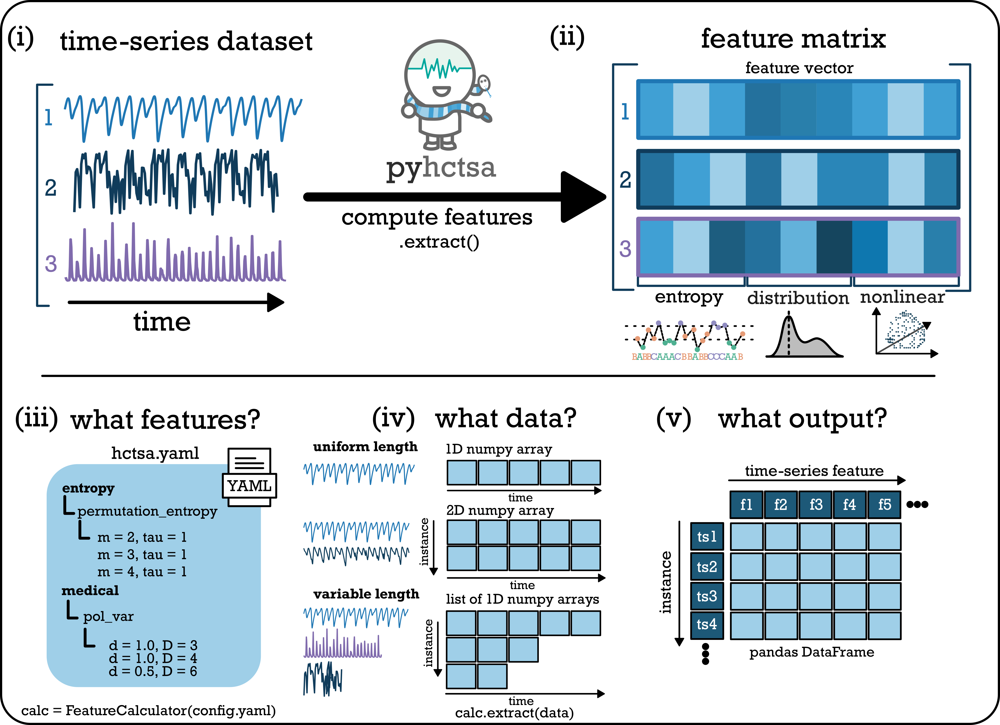

# 🐍 pyhctsa

The **PY**thon toolkit for **H**ighly **C**omparative **T**ime-**S**eries **A**nalysis (_pyhctsa_) is a living library of time-series analysis methods. It computes **over 6200 interpretable time-series features** (6250 in the default feature set: 6110 from the operations of `hctsa` plus 140 pyhctsa-only features) from a single univariate series — spanning distributional shape, autocorrelation, entropy and information theory, scaling, stationarity, nonlinear dynamics, spectral and wavelet properties, model fits, and more — making it the most comprehensive feature set available in native Python.

<figure><figcaption></figcaption></figure>

## Link to substantial documentation


