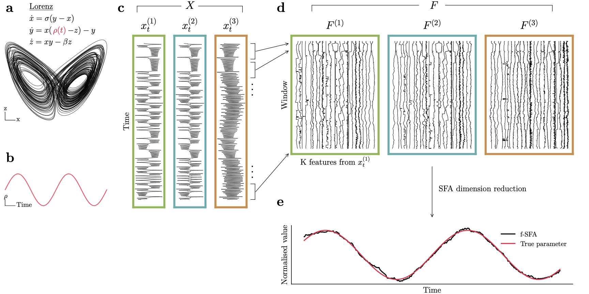

# 🐢 f-SFA

### 📕 Original Paper

📙 K.S. Owens, M. Tamaki, B.D. Fulcher. "Parameter inference from a non-stationary unknown process using statistical feature-based slow feature analysis", [_arXiv_:2609.01651 (2026)](https://arxiv.org/abs/2609.01651).

The problem that f-SFA addresses is set out in:

📙 K.S. Owens, B.D. Fulcher. "Parameter inference from a non-stationary unknown process", [_Chaos_ (2024)](https://doi.org/10.1063/5.0228236).

### ❓ What is f-SFA?

Many real-world systems are non-stationary: the rules that generate their dynamics change over time.
Often this change is driven by one or more time-varying parameters, such as the depth of sleep underlying a night of brain recordings.
Inferring these parameters from a measured time series, without knowing or learning a model of the dynamics, is the problem of Parameter Inference from a Non-stationary Unknown Process (PINUP).

Feature-based slow feature analysis (f-SFA) is a simple method for PINUP with two steps:

1. **Feature extraction.** Compute a set of time-series features (by default [_catch24_](../feature-subsets/catch22.md)) in sliding windows along each variable of the time series. This turns the data into a multivariate time series of statistical properties.
2. **Dimension reduction.** Apply slow feature analysis (SFA) to the feature time series, to find the combinations of features that vary most slowly over time.

The slowest components are estimates of the time-varying parameters.
Using a broad feature set means that you do not need to know in advance which statistical property of the dynamics the parameter affects.
Asking for slowness (instead of variance, as in PCA) stops the result from being dominated by groups of correlated features that have nothing to do with the parameter.

<figure><figcaption><p>An overview of f-SFA. (a) A Lorenz process in which the parameter ρ varies over time, as shown in (b). (c) The measured multivariate time series, X. (d) Time-series features are computed in sliding windows along each variable, giving a feature time series, F. (e) Slow feature analysis of F gives a slowly varying component (black) that tracks the true parameter (red).</p></figcaption></figure>

In the original paper, f-SFA outperformed four other PINUP methods across a range of non-stationary chaotic processes, and inferred a time-varying parameter from sleep polysomnography recordings that closely tracks depth of sleep.

### 🏃 Running f-SFA in Python

f-SFA is implemented in the _fsfa_ Python package:



Install it with `pip`:

```
pip install fsfa
```

Then, for a time series `X` stored as a `numpy` array with one row per time point and one column per variable:

```python
import fsfa

# f-SFA: the slowest component of the windowed features
tvp = fsfa.fSFA(X, window=1000, stride=100, n_components=1)

# or just the first step: a data frame of time-series features in sliding windows
df = fsfa.feature_embedding(X, window=1000, stride=100)
```

The [README](https://github.com/KieranOwens/fsfa) has a worked example that recovers the time-varying parameter of a non-stationary logistic map.

### ⚠️ Usage Guide

* **Window and stride.** The window length sets the timescale on which f-SFA can detect variation: it should be long enough to estimate each feature reliably, but short compared to the timescale on which the parameter changes.
* **Feature set.** The default is _catch24_ (the [_catch22_](../feature-subsets/catch22.md) features plus the mean and spread of each window). Other built-in choices are `'catch22'`, `'mean'`, `'meanvar'`, `'quantiles'` and `'stft'` (spectral power), and you can pass your own list of functions.
* **Number of components.** Set `n_components` above 1 if you expect more than one time-varying parameter.
* **Sign and scale.** An SFA component is defined only up to its sign, scale and offset, so compare it with a known parameter using correlation, or after a linear fit.
* **SFA settings.** _fsfa_ uses the [`sklearn-sfa`](https://sklearn-sfa.readthedocs.io/en/latest/index.html) package, and options for it can be passed through the `kwargs` argument of `fSFA`.

SFA is one of the family of time-series dimension reduction methods that we review and implement in [TSDR](tsdr-time-series-dimension-reduction.md).
